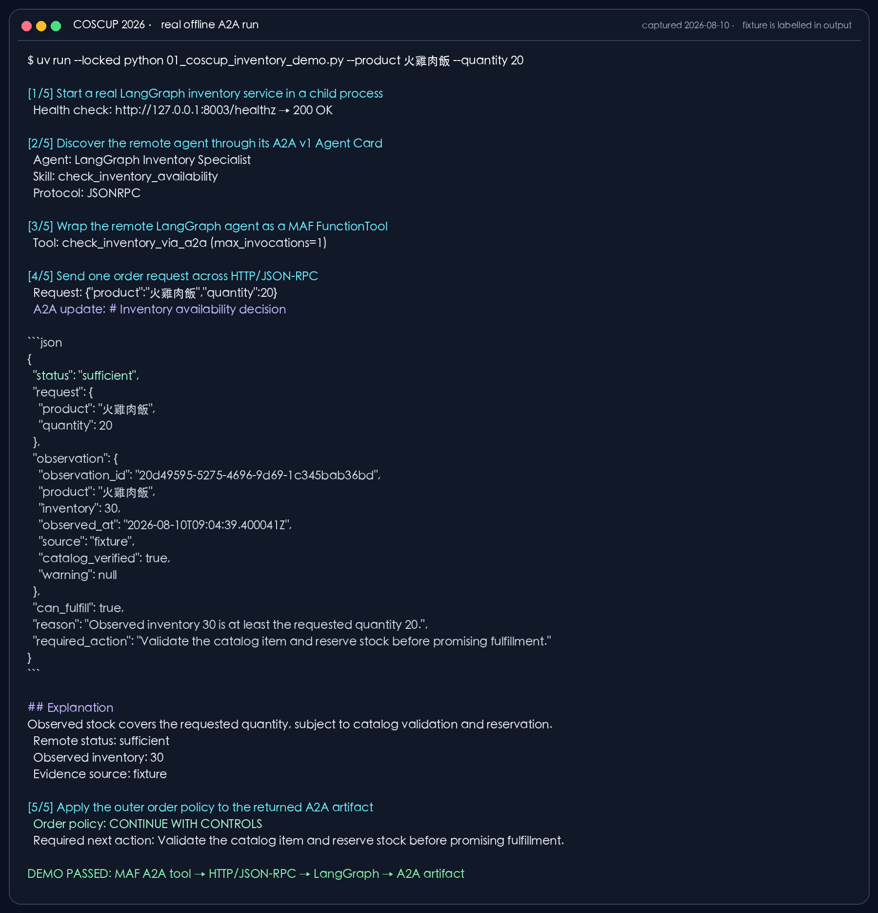
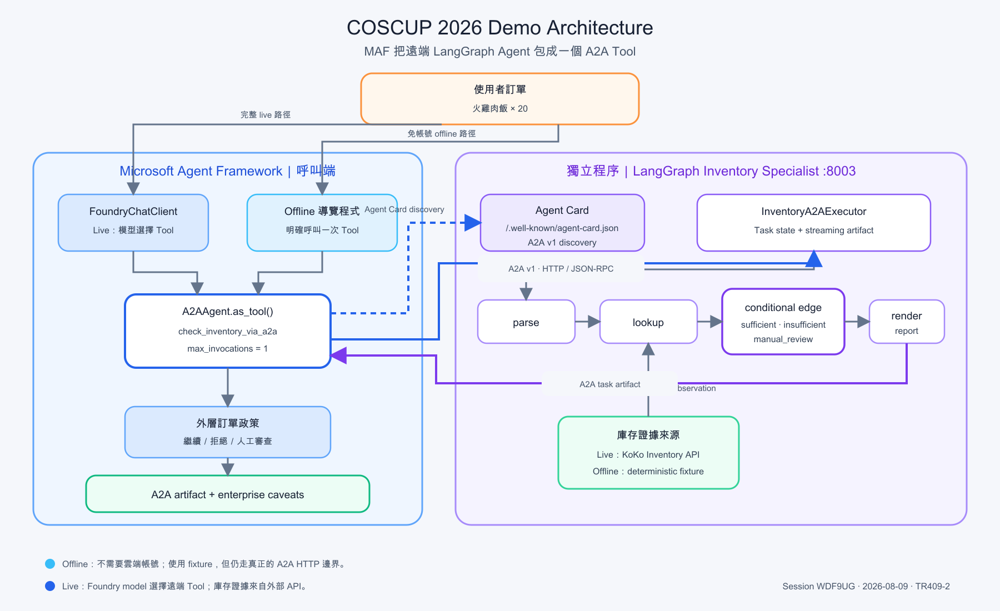

# COSCUP 2026｜MAF × LangGraph over A2A

這是 Ko Ko 在 **COSCUP x UbuCon Asia 2026** 演講的可執行延伸 Demo。它不是把兩套 framework 放進同一個 Python process 做表面比較，而是讓 **Microsoft Agent Framework（MAF）透過 A2A v1，把獨立的 LangGraph Agent 當成一個遠端 Tool**。

> **演講題目**：Is Microsoft Agent Framework "LangGraph for Enterprise"? A Source Code Deep Dive  
> **講者**：Ko Ko｜大魔術熊貓工程師  
> **場合**：COSCUP x UbuCon Asia 2026  
> **時間／地點**：2026-08-09 10:50–11:20｜TR409-2  
> **議程**：[COSCUP Session WDF9UG](https://coscup.org/2026/session/WDF9UG/)

演講本身從 MAF source code 追蹤 Agent、tool loop、handoff、Workflow、state 與 checkpoint 的控制權；這個 repo 則把結論落成一個可以親手執行的跨框架案例。

## 先在一分鐘內跑起來

這條路徑不需要 Azure、Microsoft Foundry、API key 或 `.env`。它使用明確標示的 deterministic fixture，但仍會真的啟動 localhost A2A service、走 HTTP/JSON-RPC、執行 LangGraph 並回傳 A2A artifact。

```bash
cd coscup-maf-langgraph-a2a-demo
uv sync --locked --all-groups
uv run --locked python 01_coscup_inventory_demo.py \
  --product 火雞肉飯 \
  --quantity 20
```

看到下面這一行就代表整條協作路徑成功：

```text
DEMO PASSED: MAF A2A tool → HTTP/JSON-RPC → LangGraph → A2A artifact
```



上圖是 2026-08-10 實際執行 `01_coscup_inventory_demo.py` 的終端輸出，不是示意 mockup。完整文字紀錄在 [`assets/demo-output.txt`](assets/demo-output.txt)。`source=fixture` 是刻意保留的證據標籤，不代表 live inventory。

## Demo 到底做了什麼？

使用者要求 20 份火雞肉飯後：

1. 呼叫端啟動獨立的 LangGraph Inventory Specialist。
2. 呼叫端從 `/.well-known/agent-card.json` 發現 A2A Agent Card。
3. MAF `A2AAgent.as_tool()` 把遠端 Agent 包成 `check_inventory_via_a2a`。
4. 訂單 JSON 經由 A2A v1 HTTP/JSON-RPC 送到另一個服務。
5. LangGraph 明確執行 `parse → lookup → conditional edge → render`。
6. 遠端 Agent 回傳包含 machine-readable decision 的 A2A task artifact。
7. 外層訂單政策根據 `sufficient`、`insufficient` 或 `manual_review` 決定下一步。



可編輯的向量原圖是 [`assets/architecture.svg`](assets/architecture.svg)。

## 兩種執行模式

| 能力 | Offline 導覽模式 | Microsoft Foundry Live 模式 |
|---|---:|---:|
| 需要 Azure 帳號 | 否 | 是 |
| 啟動真正的 localhost A2A server | 是 | 是 |
| Agent Card discovery | 是 | 是 |
| MAF `A2AAgent.as_tool()` | 是，導覽程式明確呼叫一次 | 是，由外層 MAF Agent 的模型選擇 |
| LangGraph conditional routing | 是 | 是 |
| 庫存來源 | 明確標示的 fixture | 外部 API；失敗時可標示 fallback |
| Foundry model explanation | 否，使用 deterministic explanation | 是 |
| 適合場合 | 第一次執行、CI、演講備援 | 完整現場 Demo、雲端整合驗證 |

Offline 模式證明的是 protocol、process、graph 與 artifact 邊界；它不宣稱模型做了 tool selection。Live 模式才包含完整的 `FoundryChatClient → MAF Agent → A2AAgent.as_tool()` model-driven loop。

## Step by step：準備環境

### 1. 安裝 uv

專案固定使用 Python 3.12，版本寫在 [`.python-version`](.python-version)，依賴則鎖在 [`uv.lock`](uv.lock)。如果尚未安裝 uv：

macOS（Homebrew）：

```bash
brew install uv
```

macOS／Linux（官方 installer）：

```bash
curl -LsSf https://astral.sh/uv/install.sh | sh
```

Windows PowerShell：

```powershell
powershell -ExecutionPolicy ByPass -c "irm https://astral.sh/uv/install.ps1 | iex"
```

詳細安裝方式請以 [Astral 官方 uv 安裝文件](https://docs.astral.sh/uv/getting-started/installation/)為準。

確認安裝：

```bash
uv --version
```

### 2. 進入專案並安裝鎖定依賴

```bash
cd coscup-maf-langgraph-a2a-demo
uv sync --locked --all-groups
```

這個指令會建立 `.venv`、準備 Python 3.12，並完全依照 `uv.lock` 安裝 runtime 與開發依賴。平常不需要手動 `source .venv/bin/activate`；`uv run` 會自動使用正確環境。

### 3. 先跑不需要憑證的 Offline Demo

```bash
uv run --locked python 01_coscup_inventory_demo.py \
  --product 火雞肉飯 \
  --quantity 20
```

也可以使用 Make：

```bash
make demo-offline
```

想觀察 `insufficient` 分支：

```bash
uv run --locked python 01_coscup_inventory_demo.py \
  --product 火雞肉飯 \
  --quantity 40
```

如果本機 `8003` 已被使用，可以換 port：

```bash
uv run --locked python 01_coscup_inventory_demo.py --port 8013
```

導覽程式結束時會主動關閉它啟動的 A2A server。

### 4. 跑完品質檢查

```bash
./scripts/check.sh
```

它會依序執行：

```text
uv sync --locked --all-groups
ruff check 01_coscup_inventory_demo.py scripts src tests
pyright 01_coscup_inventory_demo.py src tests
pytest
```

## Step by step：啟用 Microsoft Foundry Live Demo

這條路徑需要 Azure subscription、Microsoft Foundry project、可呼叫的 model deployment，以及正確的 RBAC 權限。

### 1. 安裝 Azure CLI 並登入

macOS：

```bash
brew update
brew install azure-cli
az login
```

沒有瀏覽器時可以使用：

```bash
az login --use-device-code
```

其他作業系統請看 [Microsoft 官方 Azure CLI 安裝文件](https://learn.microsoft.com/cli/azure/install-azure-cli)與 [`az login` 說明](https://learn.microsoft.com/cli/azure/get-started-with-azure-cli#sign-into-the-azure-cli)。不要在指令列或 repository 內保存帳號密碼。

確認目前登入身分：

```bash
az account show --output table
```

### 2. 建立本機設定檔

```bash
cp .env.example .env
```

編輯 `.env` 的必要欄位：

```dotenv
FOUNDRY_PROJECT_ENDPOINT=https://YOUR-RESOURCE.services.ai.azure.com/api/projects/YOUR-PROJECT
FOUNDRY_MODEL=YOUR-DEPLOYMENT-NAME
AZURE_CREDENTIAL_MODE=cli

INVENTORY_MODE=live
INVENTORY_FALLBACK_TO_FIXTURE=true
```

`FOUNDRY_PROJECT_ENDPOINT` 可以在 Foundry project 首頁取得，格式應該以 `/api/projects/{project-name}` 結尾。請參考 [Microsoft Foundry project endpoint 官方說明](https://learn.microsoft.com/python/api/overview/azure/ai-projects-readme)。

`.env` 已被 [`.gitignore`](.gitignore) 排除，請勿提交真實 endpoint、client secret、token 或其他憑證。

### 3. 執行完整庫存情境

```bash
./scripts/demo.sh inventory \
  --product 火雞肉飯 \
  --quantity 20
```

這個 script 會：

1. 在 `127.0.0.1:8003` 啟動 LangGraph inventory A2A server。
2. 等待 `/healthz` 回覆成功。
3. 建立使用同一個 Foundry deployment 的外層 MAF order orchestrator。
4. 讓模型呼叫一次 `check_inventory_via_a2a`。
5. 印出訂單 request、LangGraph A2A evidence 與 MAF 最終決策。
6. 無論成功或失敗，都清理它啟動的背景 server。

### 4. 判讀證據來源

請先看 A2A artifact 內的 `observation.source`：

- `live`：外部 inventory API 回覆並通過 schema/product 驗證。
- `fixture`：你明確選擇了 deterministic offline fixture。
- `fixture-fallback`：live API 失敗後的備援資料；流程一定進入 `manual_review`，不能授權履約。

即使狀態是 `sufficient`，也只代表一次 observation 大於等於要求數量，不代表：

- 商品已通過 catalog validation；
- 庫存已被 reservation；
- 訂單已成立、付款或履約；
- A2A 自動提供 authentication、authorization 或 compliance。

## 其他可執行情境

在 `.env` 已設定 Foundry 後，可以比較相同 prompt 或執行三回合協作：

```bash
# MAF 與 LangGraph 各自回答同一題
./scripts/demo.sh compare

# MAF → LangGraph adversarial review → MAF final synthesis
./scripts/demo.sh collaborate

# 查看兩個 reviewer 的 A2A Agent Cards
./scripts/demo.sh cards
```

三回合模式採「協調器只轉送 user-visible A2A artifact」的設計。兩邊不共享 hidden memory、checkpoint 或 framework internals。

## 建議閱讀程式碼的順序

1. [`01_coscup_inventory_demo.py`](01_coscup_inventory_demo.py)：免帳號、一步一步看完整 A2A path。
2. [`src/agent_duet/scenarios/inventory/orchestrator.py`](src/agent_duet/scenarios/inventory/orchestrator.py)：完整 Foundry MAF orchestrator 與 `A2AAgent.as_tool()`。
3. [`src/agent_duet/scenarios/inventory/server.py`](src/agent_duet/scenarios/inventory/server.py)：遠端 LangGraph A2A service 入口。
4. [`src/agent_duet/scenarios/inventory/executor.py`](src/agent_duet/scenarios/inventory/executor.py)：A2A task、streaming status 與 artifact。
5. [`src/agent_duet/scenarios/inventory/graph.py`](src/agent_duet/scenarios/inventory/graph.py)：顯式 StateGraph、conditional edges 與 deterministic decision。
6. [`src/agent_duet/scenarios/inventory/gateway.py`](src/agent_duet/scenarios/inventory/gateway.py)：外部 API、bounded retry、schema validation 與 labelled fallback。
7. [`docs/architecture.md`](docs/architecture.md)：process、state、session 與 checkpoint 邊界。
8. [`docs/source-code-comparison.md`](docs/source-code-comparison.md)：MAF 與 LangGraph apples-to-apples 對照。

## 專案結構

```text
.
├── 01_coscup_inventory_demo.py       # 最容易開始的 offline A2A 導覽
├── assets/
│   ├── architecture.svg              # 可編輯架構圖
│   ├── architecture.png              # README 架構圖片
│   ├── demo-output.txt               # 真實執行文字紀錄
│   └── demo-success.png              # 真實執行截圖
├── src/agent_duet/
│   ├── maf/                           # MAF Agent、tools、A2A executor/server
│   ├── langgraph/                     # LangGraph Agent、tools、A2A executor/server
│   ├── client/                        # discovery、compare、collaboration
│   └── scenarios/inventory/           # MAF composition + LangGraph workflow
├── tests/                              # graph、gateway、A2A round trip、session tests
├── scripts/
│   ├── demo.sh                        # 啟動 live services 並執行情境
│   ├── check.sh                       # lint、type check、tests
│   ├── capture_demo_output.py         # 真正執行 Demo 並保存 transcript
│   └── render_terminal_screenshot.py  # 從實際 transcript 重建截圖
├── docs/                               # 架構、情境、官方來源與 code comparison
├── .env.example
├── pyproject.toml
└── uv.lock
```

## 這個 Demo 證明與沒有證明的事

它證明：

- MAF 可以用一致的 Agent abstraction 包裝不同框架實作的遠端 Agent。
- 呼叫端與 LangGraph service 透過 A2A v1 交換 Agent Card、task state、message 與 artifact。
- LangGraph 可以把商業決策路徑寫成顯式 node 與 conditional edge。
- framework state 不需要、也不應該假裝跨 runtime 共享。

它沒有證明：

- MAF 會執行或看見 LangGraph 的內部 graph。
- A2A caller 可以讀取遠端 hidden prompt、tools、memory 或 checkpoint。
- in-memory task store/checkpointer 已具備 production durability。
- localhost demo 的網路邊界已具備 production authentication 或 authorization。

## 常見問題

### `Address already in use`

Offline 模式改用其他 port：

```bash
uv run --locked python 01_coscup_inventory_demo.py --port 8013
```

Live 模式則修改 `.env` 中的 `INVENTORY_AGENT_PORT` 與 `INVENTORY_AGENT_PUBLIC_URL`，兩者必須一致。

### `Missing required Microsoft Foundry settings`

確認 `.env` 存在，而且 `FOUNDRY_PROJECT_ENDPOINT`、`FOUNDRY_MODEL` 不是 placeholder。Offline 導覽程式不會要求這兩個欄位。

### Azure authentication failed

```bash
az login
az account show --output table
```

確認登入 tenant/subscription 正確，且登入身分對 Foundry project/model deployment 具有必要權限。

### Live inventory API 失敗卻還有結果

如果 `INVENTORY_FALLBACK_TO_FIXTURE=true`，artifact 會明確標成 `fixture-fallback`，並強制 `manual_review`。這是現場 Demo 的可預期退路，不是偽裝成 live success。

## 安全與正式環境界線

- 服務預設只綁定 `127.0.0.1`，不要直接暴露到 Internet。
- Demo 沒有 application-layer authentication；正式部署必須在 gateway/service boundary 補上 identity、authentication、authorization、rate limit 與 audit。
- Container 不應複製本機 Azure CLI token。正式 Azure workload 優先使用 workload identity／managed identity。
- 不要記錄 prompt、model response、A2A artifact 或個資，除非已完成資料分類、遮罩、保存期限與存取控制設計。

更完整的揭露與回報方式請看 [`SECURITY.md`](SECURITY.md)。

## 版本與授權

這份 snapshot 固定使用 `uv.lock`，主要版本包括 Microsoft Agent Framework Python 1.12.1、LangGraph 1.2.9 與 A2A SDK 1.1.2。因為相關套件仍快速演進，升級後請重新執行完整品質檢查與 A2A round-trip tests。

本專案採 [MIT License](LICENSE)。貢獻方式請看 [`CONTRIBUTING.md`](CONTRIBUTING.md)，行為準則請看 [`CODE_OF_CONDUCT.md`](CODE_OF_CONDUCT.md)。
