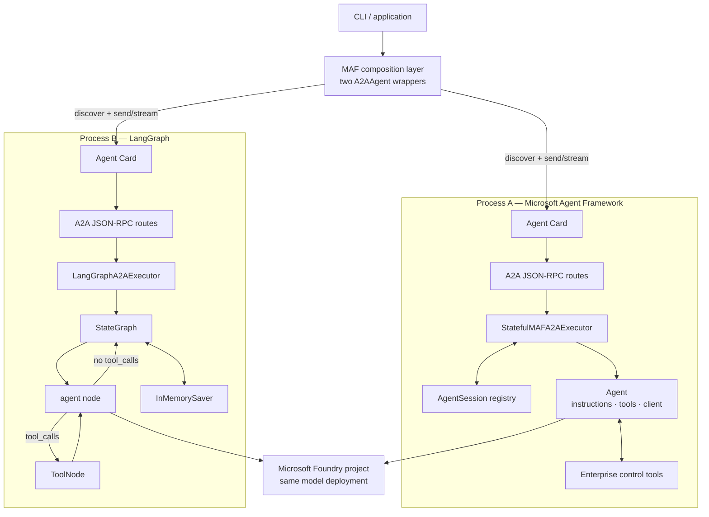
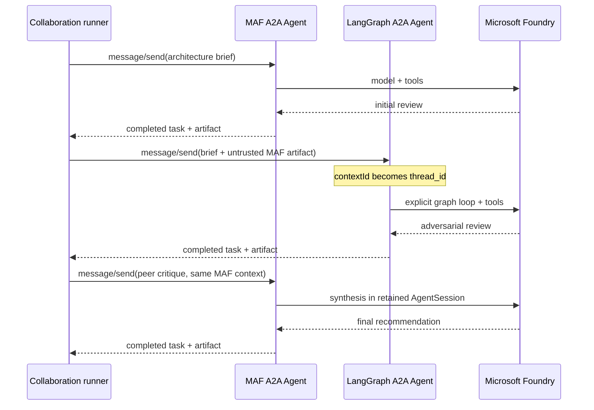
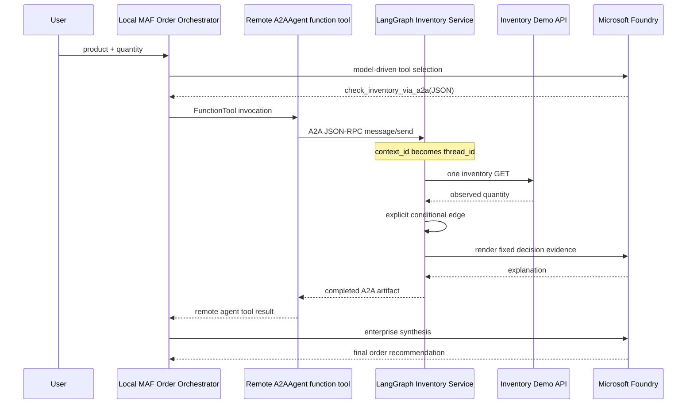

# Architecture and runtime boundaries

## Deployment view

## Conversation identity mapping

| Layer | MAF service | LangGraph service |
|---|---|---|
| A2A conversation | `context_id` | `context_id` |
| Framework key | `AgentSession.session_id` | `configurable.thread_id` |
| Mapping | `a2a:{context_id}` | `thread_id = context_id` |
| Demo storage | in-process registry | `InMemorySaver` |
| Production replacement | tenant-bound durable session store | persistent checkpointer |

The identifiers correlate state; they are not authentication tokens. A
production service must bind them to an authenticated tenant/user and authorize
every read or mutation.

## Protocol boundary

A2A crosses the service boundary with:

- Agent Card metadata and skills;
- user/agent messages;
- task status;
- public artifacts;
- context and task identifiers.

A2A does not cross the boundary with:

- MAF `AgentSession.state`;
- LangGraph `MessagesState`;
- checkpointer records;
- private tools or credentials;
- model-hidden reasoning;
- graph nodes and edges.

This separation is why the project calls the design **cross-runtime
composition**, not a shared runtime.

## Collaboration sequence

The coordinator is intentional. Open protocols do not imply that agents should
autonomously discover and call arbitrary peers.

## Inventory composition sequence

The optional inventory scenario uses a different composition style from the
mediated peer review:

This combines two MAF concepts without conflating them:

1. `A2AAgent` supplies the transport-level remote Agent abstraction.
2. `A2AAgent.as_tool()` supplies the model-driven composition abstraction.

MAF never executes the remote LangGraph graph. The outer agent receives only
the remote tool's public result, while LangGraph retains its own graph state,
checkpoint, inventory gateway, and Foundry model call.
