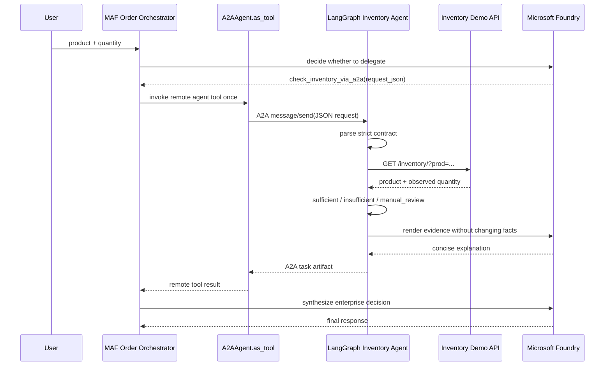
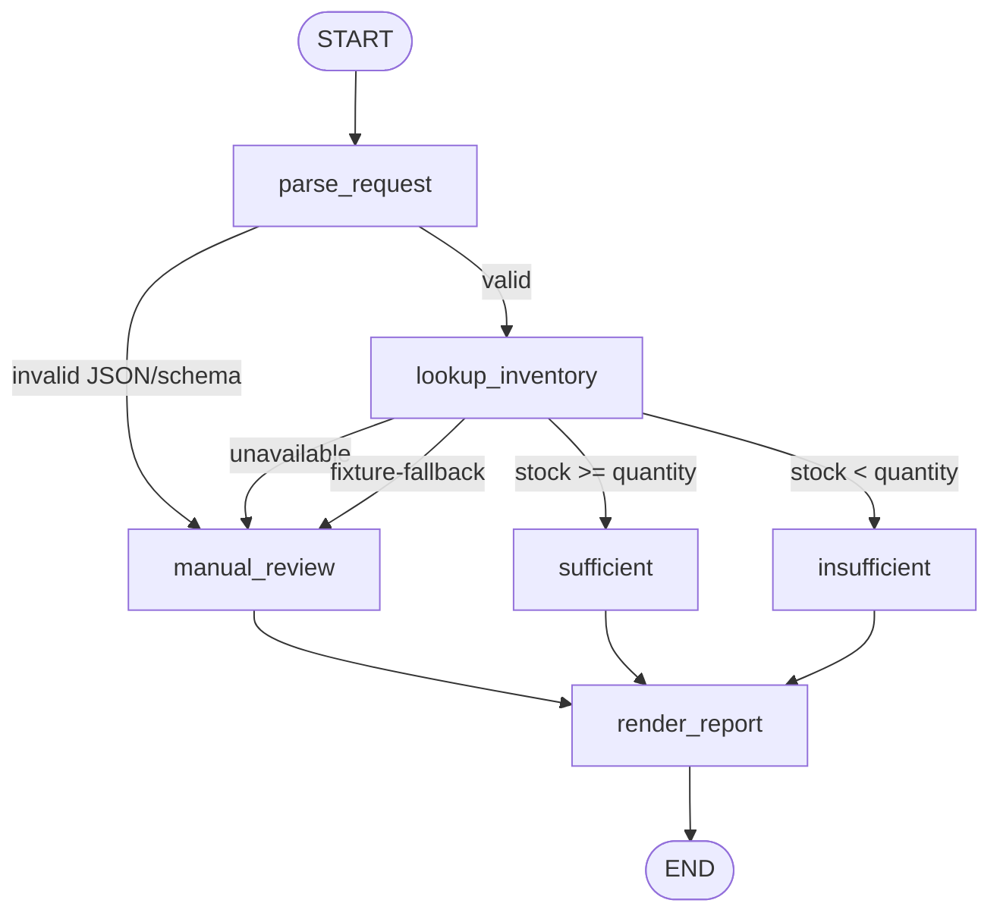

# Inventory business scenario

This scenario demonstrates MAF composition across a real A2A service boundary
without changing the controlled architecture-review comparison.

## Runtime design



The outer MAF agent uses the built-in `A2AAgent.as_tool()` API. From the MAF
model's perspective, `check_inventory_via_a2a` is one function tool. The
function implementation is a remote A2A agent with its own runtime, graph,
checkpointer, model invocation, and external dependency.

Source:

- [`orchestrator.py`](../src/agent_duet/scenarios/inventory/orchestrator.py)
- [`graph.py`](../src/agent_duet/scenarios/inventory/graph.py)
- [`gateway.py`](../src/agent_duet/scenarios/inventory/gateway.py)
- [`executor.py`](../src/agent_duet/scenarios/inventory/executor.py)
- [`server.py`](../src/agent_duet/scenarios/inventory/server.py)

## LangGraph workflow



The workflow deliberately performs the inventory lookup in a deterministic
node rather than allowing an LLM to call it repeatedly. A task receives one
observation. The Foundry model is used only after the decision to render a
short explanation; the machine-readable decision is generated before that
model call and included unchanged in the A2A artifact.

## A2A request contract

The remote Agent accepts text because its A2A skill advertises `text/plain`,
but that text must be a strict JSON object:

```json
{
  "product": "火雞肉飯",
  "quantity": 20
}
```

Unknown fields, blank products, quantities below 1, and quantities above
10,000 are rejected into `manual_review`. Free-form instructions do not reach
the inventory API.

## Live endpoint observations

During implementation on 2026-07-26/27, the supplied demo endpoint exhibited:

- HTTP 200 with `{"inventory": number, "prod": string}` for a valid query;
- HTTP 422 when `prod` was absent;
- HTTP 200 for an unknown product string;
- different inventory values across repeated requests for the same product;
- HTTP 405 for `OPTIONS`.

These are observations, not a promised API contract. The gateway therefore:

- validates every response;
- URL-encodes the product through `httpx` query parameters;
- retries only network errors, timeouts, HTTP 429, and HTTP 5xx;
- never retries semantic HTTP 4xx responses;
- limits attempts to at most three;
- marks catalog validation as false for live responses;
- never claims that the observed quantity has been reserved.

## Live, fixture, and fallback modes

| Mode/source | Meaning | May return sufficient? |
|---|---|---|
| `live` | Observation returned by the demo API | Yes, with catalog/reservation caveats |
| `fixture` | Explicit deterministic rehearsal mode | Yes, visibly labelled |
| `fixture-fallback` | Live call failed and fallback was enabled | No; always `manual_review` |

Default fixture values:

| Product | Quantity |
|---|---:|
| 火雞肉飯 | 30 |
| 珍珠奶茶 | 12 |
| 雞排 | 0 |
| Unknown product | 0 |

## Run

Configure Microsoft Foundry and sign in:

```bash
cp .env.example .env
az login
```

Live:

```bash
./scripts/demo.sh inventory --product 火雞肉飯 --quantity 20
```

Deterministic rehearsal:

```dotenv
INVENTORY_MODE=fixture
```

```bash
./scripts/demo.sh inventory --product 火雞肉飯 --quantity 20
```

The inventory service alone can be started with:

```bash
uv run langgraph-inventory-a2a-server
```

Then, in another terminal:

```bash
uv run agent-duet inventory --product 火雞肉飯 --quantity 20
```

## Production boundary

This scenario makes an availability recommendation. It does not place an
order, charge a customer, validate a catalog item, or reserve inventory.

A production replacement needs authenticated service-to-service access,
authorization, SKU identifiers rather than display names, an atomic
availability-and-reservation operation, idempotency keys, a durable task store,
tenant isolation, tracing, and an explicit human/policy approval boundary.
